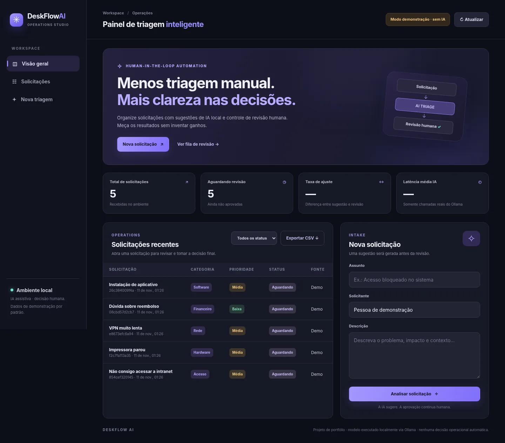
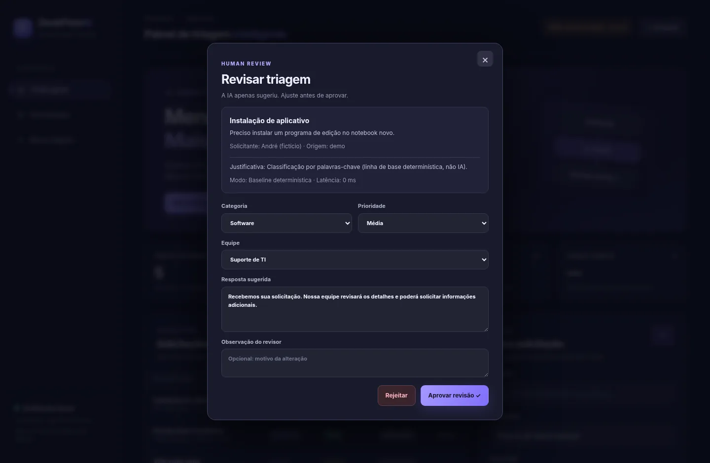
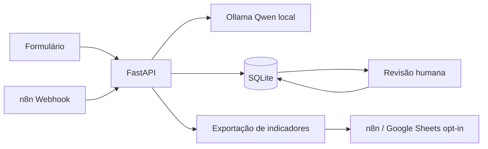

# DeskFlow AI

**Triagem inteligente de solicitações com IA local, n8n e revisão humana.**

Projeto de portfólio voltado à construção de automações corporativas com inteligência artificial. O DeskFlow recebe solicitações em linguagem natural, utiliza **Qwen via Ollama** para sugerir categoria, prioridade, equipe e resposta, e apresenta os resultados para **aprovação ou rejeição humana**. O painel registra métricas verificáveis e permite receber entradas pelo **n8n**. A sincronização de metadados com Google Sheets é opcional.

> **Estado:** MVP local implementado e testado com respostas simuladas do LLM. A execução real do Qwen, a importação do n8n e a sincronização com Google Sheets precisam ser validadas no computador do usuário. O projeto não declara uso empresarial em produção nem resultados de economia de horas não medidos.

## Interface



*Painel renderizado com cinco solicitações fictícias. O status “Modo demonstração · sem IA” indica a classificação por regras, não execução do Qwen. A captura foi feita em Chromium com recursos locais da aplicação e respostas da API reproduzidas por um transporte de teste.*



*Revisão humana: categoria, prioridade, equipe e resposta podem ser ajustadas antes de aprovar ou rejeitar. Esta captura também utiliza dados sintéticos e a linha de base determinística.*

## Recursos

| Funcionalidade | Comportamento |
| --- | --- |
| Entrada de solicitações | Formulário web e webhook importável no n8n. |
| IA local | JSON estruturado gerado pelo Qwen via Ollama para triagem assistida. |
| Revisão humana | Aprovar/rejeitar, editar prioridade, categoria e resposta. Sugestão nunca é aplicada como decisão final automática. |
| Métricas verificáveis | Totais, pendências, revisões, ajustes humanos e latência média das chamadas LLM reais. |
| Persistência | SQLite local e histórico de revisões. |
| Google Sheets | Workflow **opt-in** de sincronização de metadados, sem descrição ou identificação do solicitante. |
| Avaliação | 16 casos sintéticos rotulados para comparar baseline por palavras-chave e Qwen real. |
| Qualidade e segurança | Pytest, checagem preventiva antes de publicar, validação de entrada e autenticação da integração n8n. |

## Tecnologias

**Backend:** Python 3.11+, FastAPI, Pydantic, SQLite, HTTPX.  **Modelo:** Qwen3 4B Instruct no Ollama.  **Automação:** n8n com webhook + integração Google Sheets opcional.  **Interface:** HTML, CSS e JavaScript sem dependências frontend externas.  **Testes:** pytest + dados sintéticos.

## Arquitetura



A **IA sugere**, o **backend valida e persiste**, e uma **pessoa decide**. O modelo não recebe autorização para executar comandos do computador ou aprovar tickets por conta própria.

## Instalação rápida no Windows

### 1. Clonar o repositório

```powershell
git clone https://github.com/Tyago03/DeskFlow-AI.git
cd DeskFlow-AI
```

> O repositório público já está disponível. Para executar a cópia ZIP sem Git, extraia o pacote e entre na pasta `DeskFlow_AI`.

### 2. Instalar o Qwen no Ollama

Instale o [Ollama](https://ollama.com/download), abra-o e execute:

```powershell
ollama pull qwen3:4b-instruct
ollama list
```

### 3. Iniciar o DeskFlow

Abra **`INICIAR_DESKFLOW.bat`** na raiz do projeto. Ele cria `.venv`, instala dependências, inicia o FastAPI e abre `http://127.0.0.1:8000`.

Para testar:

```powershell
.\TESTAR_DESKFLOW.bat
```

Para executar sem Ollama, **apenas para demonstração com regras**, rode no terminal antes de iniciar:

```powershell
$env:DESKFLOW_DEMO_MODE="1"
.\INICIAR_DESKFLOW.bat
```

Esse modo é **baseline determinístico, não IA**; a interface sinaliza isso. Use `.\.venv\Scripts\python.exe -m scripts.seed_demo` para inserir cinco solicitações **inteiramente fictícias** e capturar uma tela com dados de demonstração.

## Integração n8n

O repositório inclui `compose.yaml` e **dois fluxos importáveis**:

1. `workflows/01_entrada_n8n.json`: webhook → autenticação Header Auth → API DeskFlow → resposta.
2. `workflows/02_exportar_google_sheets.json`: execução manual → consulta de metadados → Google Sheets (opcional, precisa de sua credencial OAuth).

Para configurar: `CONFIGURAR_INTEGRACAO.bat` gera uma chave **local** em `.env`, que nunca deve ser versionada. Depois, `INICIAR_N8N.bat` sobe o painel do n8n no Docker Desktop e `INICIAR_COM_N8N.bat` permite que o contêiner alcance o FastAPI. **Essa opção coloca o backend escutando em `0.0.0.0`: restrinja o firewall e não abra a porta na internet.**

O n8n exige que a credencial **Header Auth** com nome `X-DeskFlow-Key` seja configurada manualmente no editor. Isso evita embutir tokens nos workflows.

[Leia as instruções completas de n8n e Google Sheets](docs/N8N_E_GOOGLE_SHEETS.md).

## Avaliação e métricas

A separação entre resultados comprovados e expectativas é deliberada. Para avaliar a linha de base (não IA):

```powershell
.\.venv\Scripts\python.exe -m scripts.evaluate --mode baseline
```

Para avaliar o Qwen real, com Ollama em execução:

```powershell
.\AVALIAR_DESKFLOW.bat
```

A avaliação calcula acerto de **categoria**, **prioridade**, acerto conjunto e latência em **16 solicitações sintéticas**. Os resultados ficam em `evaluation/results/` e são ignorados pelo Git. **Não equivalem a ganhos de produtividade nem precisão em produção.**

O painel também apresenta a **taxa de ajustes humanos**, calculada a partir das revisões realizadas, e latência média **somente das chamadas reais ao Ollama** (nunca da baseline demo).

## Segurança e privacidade

- O FastAPI inicia localmente em `127.0.0.1`; **não é uma aplicação multiusuário nem um serviço público autenticado**.
- Não exponha a porta 8000 ao público. O modo n8n Docker usa `0.0.0.0` apenas para integração local e exige proteção adicional na rede.
- Chaves ficam em variáveis de ambiente ou `.env` ignorado; nunca nos workflows, código, prints ou GitHub.
- Exportação para Google Sheets exclui descrição, título e identificação do solicitante.
- Dados fornecidos ao modelo local podem conter informações pessoais: **não use dados reais de clientes/funcionários no portfólio** sem autorização e controles apropriados.
- O modelo não decide sozinho, não executa comandos e não efetua alterações além de sugerir a triagem inicial.
- O script `scripts/preflight.py` faz checagens heurísticas antes de publicar: não substitui auditoria de segurança.

## Estrutura

```text
DeskFlow_AI/
├── app/                    # API, classificador, SQLite, interface
│   └── static/             # Frontend sem CDN
├── workflows/              # 2 fluxos n8n importáveis
├── datasets/               # Conjunto sintético de avaliação
├── scripts/                # Avaliação, demo e checagem de publicação
├── tests/                  # Testes automatizados
├── docs/                   # Arquitetura, n8n e screenshot demo
├── compose.yaml            # n8n opcional via Docker
├── requirements*.txt
├── INICIAR_DESKFLOW.bat
├── INICIAR_N8N.bat
├── CONFIGURAR_INTEGRACAO.bat
├── TESTAR_DESKFLOW.bat
└── docs/preview.webp       # Interface em modo de demonstração
```

## Repositório público

O código está publicado em [Tyago03/DeskFlow-AI](https://github.com/Tyago03/DeskFlow-AI). Clone-o usando as instruções acima. Arquivos locais, como `.env`, banco SQLite, logs, resultados pessoais e modelos baixados, não integram a publicação.

As duas imagens deste README são **demonstrações com dados sintéticos**. Para conferir a integração com Qwen e n8n em seu ambiente, execute as etapas de instalação, avaliação e importação dos workflows. Não considere a captura de tela prova de execução real de IA ou de impacto de negócio.

## Limitações e evolução

MVP educacional e local: sem login por colaborador, SLA real, fluxo de e-mails corporativos, autorização por equipe, fila assíncrona, multiusuário ou deploy público. Não foi executado n8n Docker nem Google Sheets com credenciais reais no ambiente de desenvolvimento. Próximas evoluções: autenticação, filas, avaliações com amostra maior, segmentação temporal e dados reais apenas com governança/LGPD.

[Decisões técnicas](docs/ARQUITETURA.md) · [Resultados do laboratório](docs/RESULTADOS_DE_LABORATORIO.md) · [Roteiro de demonstração](docs/ROTEIRO_DE_DEMONSTRACAO.md) · [Documentação Ollama](https://docs.ollama.com/api/chat) · [Webhook n8n](https://docs.n8n.io/integrations/builtin/core-nodes/n8n-nodes-base.webhook/) · [Google Sheets no n8n](https://docs.n8n.io/integrations/builtin/app-nodes/n8n-nodes-base.googlesheets/)

---

**Autor:** Tyago Vitorino Ferreira · Projeto desenvolvido com assistência de ferramentas de IA e revisão do código e decisões técnicas. O modelo Qwen, Ollama, n8n e dependências são tecnologias de terceiros.
