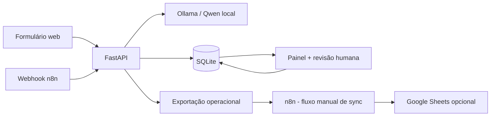

# Arquitetura e decisões técnicas

## Problema

Solicitações empresariais chegam por mensagens livres, exigindo leitura, classificação, atribuição preliminar de prioridade e preparação de resposta. O DeskFlow AI demonstra uma forma de **assistir** essas tarefas, mantendo a decisão humana como etapa explícita.

## Componentes

- **API / ticket:** recebe título, descrição e solicitante; aplica validação de tamanho/formato.
- **OllamaTriage:** devolve JSON estruturado. Somente sugere categoria, prioridade, equipe e resposta.
- **Persistência:** escreve resultado original de classificação; não atualiza o valor proposto após revisão. Guarda a decisão final em colunas separadas.
- **Auditoria:** `reviews` registra quem aprovou/rejeitou e divergências; revisões concorrentes falham com 409.
- **Métricas:** totais, solicitações pendentes, taxa de ajustes humanos, latência medida das chamadas reais do modelo.
- **Automação:** o n8n encaminha solicitações para um endpoint específico que exige segredo `X-DeskFlow-Key`.
- **Planilha opcional:** endpoint de exportação sem descrição/título/nome do solicitante; sincronização manual e desativada por padrão.

## Separação IA vs baseline

- Modo padrão: `DESKFLOW_DEMO_MODE=0`, usa o Qwen instalado no Ollama.
- Modo demo: `DESKFLOW_DEMO_MODE=1`, faz triagem **determinística por palavras-chave**, sem LLM. A interface mostra o rótulo `Modo demonstração · sem IA`.
- A confiança numérica do modelo é **autoestimada, não calibrada**. Ela é exibida apenas na revisão, não usada como autonomia para aprovação.

## Segurança e limites

1. Não integrar automaticamente com sistemas de RH/atendimento reais sem autorização, privacidade e política de retenção.
2. Não usar respostas geradas como ordens; nenhuma alteração no banco além da criação da triagem ocorre sem decisão humana.
3. `/api/integrations/*` utiliza uma chave gerada localmente; o n8n guarda credencial em Header Auth configurada pelo usuário.
4. `host.docker.internal` requer backend acessível ao contêiner. O modo integração escuta em 0.0.0.0 e **deve ser restrito pelo firewall**: é para desenvolvimento local, não para exposição pública.
5. Testes em `pytest` utilizam mock para o modelo; há avaliação separada com um conjunto sintético e execução real opcional.
6. Exportação CSV sanitiza células com prefixos de fórmula. O fluxo de Sheets exporta só metadados operacionais.
7. A aplicação não implementa login/multiusuário, fila de tarefas ou SLA. É um MVP educacional local, não sistema de produção.

## Métricas — interpretação correta

- **Acerto de categoria/prioridade:** medido pelo script `evaluate` em 16 casos sintéticos rotulados. É uma amostra de laboratório.
- **Taxa de ajuste humano:** percentual de revisões em que categoria ou prioridade final divergem da sugestão, apenas entre revisões efetivamente realizadas.
- **Latência:** média do tempo de chamada do Ollama medida em milissegundos; não é equivalente a tempo do processo de suporte.
- **Tempo economizado:** **não é medido automaticamente nem declarado**. Seria necessário medir um grupo de controle humano, em condições comparáveis, antes de fazer tal afirmação.

## Evoluções futuras

Autenticação, autorização por papel, processos assíncronos, filas, logs estruturados com redaction, SLA real, métricas por período, tratamento de dados pessoais sob LGPD, aprovação com identidade auditável e deploy interno seguro. Essas entregas não estão incluídas no MVP.
